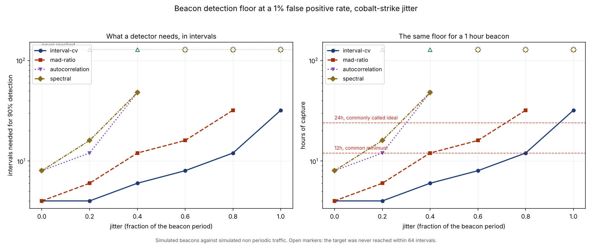

# zeek-beacon-floor

[](https://github.com/__GITHUB_USERNAME__/zeek-beacon-floor/actions/workflows/ci.yml)
[](https://__GITHUB_USERNAME__.github.io/zeek-beacon-floor/)
[](https://pypi.org/project/zeek-beacon-floor/)
[](pyproject.toml)
[](pyproject.toml)
[](LICENSE)

Beacon hunting guidance says to capture at least
<!--number:guidance.minimum_hours-->12<!--/number--> hours of traffic,
<!--number:guidance.ideal_hours-->24<!--/number--> ideally.

No detector sees a clock. What they consume is inter arrival times, and how
many of those a capture window yields depends entirely on the beacon's period,
which is the one thing a hunter does not know before they look.

This measures the detection floor in the units detectors actually work in, then
converts it back into hours so the guidance becomes checkable.

```bash
pip install zeek-beacon-floor
```

```bash
zbf score conn.log          # rank the pairs in a Zeek conn.log
zbf hours --periods 3600    # how long must I watch for an hourly beacon?
```

## Every number published here is a simulation

No conn.log from a real network was used. The beacons are generated and so is
the background traffic. One behaviour is sourced, Cobalt Strike's jitter
semantics; everything else is a declared choice listed in `docs/metrics.json`.

[`docs/limitations.md`](docs/limitations.md) is the list of reasons not to over
read these figures, and it leads with a bigger one than the simulation: this
measures periodic against not periodic, which is not the question a hunter
asks. More on that below.

## The floor



Intervals needed for 90 percent detection at a 1 percent false positive rate,
averaged over <!--number:conditions.seeds-->8<!--/number--> seeds:

| detector | no jitter | 40% jitter | 80% jitter | 100% jitter |
| --- | --- | --- | --- | --- |
| `interval-cv` | <!--number:headline.interval-cv.intervals_needed_by_jitter.0-->4<!--/number--> | <!--number:headline.interval-cv.intervals_needed_by_jitter.40-->6<!--/number--> | <!--number:headline.interval-cv.intervals_needed_by_jitter.80-->12<!--/number--> | <!--number:headline.interval-cv.intervals_needed_by_jitter.100-->32<!--/number--> |
| `mad-ratio` | <!--number:headline.mad-ratio.intervals_needed_by_jitter.0-->4<!--/number--> | <!--number:headline.mad-ratio.intervals_needed_by_jitter.40-->12<!--/number--> | <!--number:headline.mad-ratio.intervals_needed_by_jitter.80-->32<!--/number--> | never |
| `autocorrelation` | <!--number:headline.autocorrelation.intervals_needed_by_jitter.0-->8<!--/number--> | <!--number:headline.autocorrelation.intervals_needed_by_jitter.40-->48<!--/number--> | never | never |
| `spectral` | <!--number:headline.spectral.intervals_needed_by_jitter.0-->8<!--/number--> | <!--number:headline.spectral.intervals_needed_by_jitter.40-->48<!--/number--> | never | never |
| `bowley-skew` | never | never | never | never |

The plain dispersion statistic wins, which is the opposite of what the extra
machinery in a spectral method suggests. Autocorrelation and the FFT need a
longer and cleaner series to form a peak, and jitter accumulates as phase drift
that smears it.

`bowley-skew` never reaches the target anywhere. That is a measured negative
result and it is kept rather than deleted, because it declared in its own
`blind_to` field, before the sweep ran, that symmetric jitter is skew free and
would therefore score like a perfect beacon. See
[ADR 003](docs/adr/adr-003-keep-the-detector-that-fails.md).

## The same floor, in hours

`interval-cv`, at 100 percent jitter:

| beacon period | hours of capture needed |
| --- | --- |
| 1 minute | <!--number:hours_of_capture.interval-cv.100.60-->0.5<!--/number--> |
| 5 minutes | <!--number:hours_of_capture.interval-cv.100.300-->2.7<!--/number--> |
| 1 hour | <!--number:hours_of_capture.interval-cv.100.3600-->32<!--/number--> |
| 1 day | <!--number:hours_of_capture.interval-cv.100.86400-->768<!--/number--> |

Same detector, same floor of
<!--number:headline.interval-cv.intervals_needed_by_jitter.100-->32<!--/number-->
intervals, and the capture window it implies runs from about half an hour to a
month. A one minute beacon is found well inside the
<!--number:guidance.minimum_hours-->12<!--/number--> hour minimum. An hourly one
needs more than the <!--number:guidance.ideal_hours-->24<!--/number--> hours
called ideal. A daily one needs
<!--number:hours_of_capture.interval-cv.100.86400-->768<!--/number--> hours,
which is a month of capture to find one beacon.

The guidance is not wrong. It is advice about a capture window given in the
only unit anyone can give it in without knowing the beacon period. The claim
here is narrower: the unit hides a dependency, the dependency spans orders of
magnitude, and a hunter who can assume a period can do better than a fixed
window.

## What this cannot tell you

A monitoring agent checking in every sixty seconds is periodic. So is a
software update check, a certificate revocation poll and a heartbeat to a load
balancer. Every detector here scores them exactly as it scores a beacon,
because they are beacons in every respect except intent.

**No timing statistic separates malicious from benign.** What is measured here
is periodic against not periodic. A deployment turns that into alerts by adding
things this tool does not have: what the destination is, whether that software
belongs on that host, what the payload sizes look like, and whether anyone can
account for it.

`zbf score` prints that under its own output, and a test asserts the line is
still there.

## Using it on a real conn.log

```bash
zbf fields conn.log    # what this Zeek version called things
zbf score conn.log --top 20
```

```
pair                                            conns    period   hours  interval-cv  autocorrelation
10.0.0.9 -> 203.0.113.5:443                        41     10.0m     6.8        0.981            0.943
10.0.0.9 -> 198.51.100.7:80                        38      9.4m     5.9        0.112            0.087
```

Both TSV and JSON conn.logs are read, gzipped or not. The TSV reader takes
column names from the `#fields` header rather than assuming positions, because
Zeek 8 added `ip_proto` and every column after it moved: a reader that
hardcodes `conn_state` at index 11 reads `local_orig` on a Zeek 8 log, gets a
plausible string back, and reports nothing wrong. A headerless TSV is refused
rather than guessed.

<!--number:runtime[1].connections-->245,000<!--/number--> connections across
<!--number:runtime[1].pairs-->10,000<!--/number--> pairs, scored by all five
detectors, takes
<!--number:runtime[1].seconds-->5.9<!--/number--> seconds.

## The detectors

```bash
zbf detectors
```

Each declares what it ranks by and what it is blind to. `blind_to` is a
required field that raises when empty: a detector is a decision about what to
ignore, and one that claims to ignore nothing has an assumption nobody has
looked for yet.

Below its minimum number of intervals a detector returns nothing rather than a
low score, and the output prints `too short`. The two mean different things to
a hunter: one is "not a beacon", the other is "ask me again when you have
watched longer".

## The jitter model is not a detail

Cobalt Strike's `sleep` takes a jitter percentage that only ever shortens the
sleep: `sleep 300 20` produces 240 to 300 seconds. The symmetric model most
tooling assumes varies the interval both ways, spreading it over twice the
range at the same stated percentage.

At 80 percent jitter `mad-ratio` needs
<!--number:jitter_models.mad-ratio.cobalt-strike.80-->32<!--/number-->
intervals under the sourced model and
<!--number:jitter_models.mad-ratio.symmetric.80-->64<!--/number--> under the
symmetric one. A floor quoted at a jitter percentage means two different things
depending on which was meant, which is worth knowing before comparing any two
beacon detection results.

## Decisions

- [ADR 001](docs/adr/adr-001-measure-in-intervals-not-hours.md): measure in
  intervals observed, not hours of capture.
- [ADR 002](docs/adr/adr-002-generous-to-the-detectors.md): when in doubt, be
  generous to the detectors, and say so.
- [ADR 003](docs/adr/adr-003-keep-the-detector-that-fails.md): keep the
  detector that fails.

## Development

```bash
make install
make check       # every gate CI runs: dashes, tables, published numbers,
                 # dependencies, generated docs, format, lint, tests
make bench       # rerun the benchmark and rewrite docs/metrics.json
make report      # regenerate docs/results.md and the chart
```

Every figure in this README and under `docs/` is tagged with the metrics path
it came from, and `tools/check_numbers.py` fails the build when a published
number stops matching the measured one. `docs/results.md` is generated rather
than written.

Nothing under `src/` opens a socket, and CI enforces that. This is a tool an
analyst should be able to run on an isolated host holding evidence.

## Licence

MIT. See [LICENSE](LICENSE).
